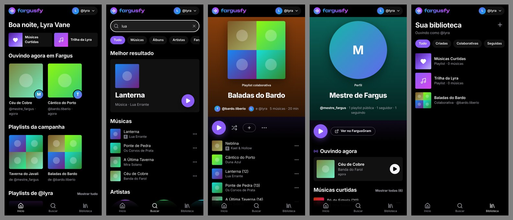

# FargusFy

[](https://github.com/EnricoDiGioia/FargusFy/actions/workflows/deploy.yml)

App de música no estilo Spotify para os personagens de uma campanha de RPG. Cada personagem do [FargusGram](https://github.com/EnricoDiGioia/FargusGram) tem playlists, músicas curtidas, playlists montadas em grupo e um "ouvindo agora" que o resto da campanha vê. As músicas são as do catálogo do Spotify, tocadas pelos players oficiais do próprio Spotify.

É o app irmão do FargusGram: usa o mesmo banco, a mesma conta, os mesmos personagens e o mesmo tema. Quem entrou num já está logado no outro, e trocar de personagem num troca no outro. Também é um PWA e funciona no plano grátis do Supabase e do GitHub Pages.

**No ar:** https://enricodigioia.github.io/FargusFy/ (entra com a conta do FargusGram)



## Funcionalidades

**Ouvir**
- Busca no catálogo do Spotify (músicas, álbuns e artistas) e nos personagens e playlists da campanha
- Páginas de álbum e de artista com a discografia
- Fila com "tocar em seguida", "adicionar à fila", aleatório e repetir; a fila continua de onde parou ao reabrir o app
- Player embutido do Spotify para todo mundo e player completo para até 5 contas Premium (veja [Como o áudio toca](#como-o-áudio-toca))

**Biblioteca do personagem**
- Playlists públicas ou privadas: criar, editar, reordenar, copiar músicas para outra playlist
- Músicas curtidas e playlists seguidas
- Playlists colaborativas: o dono convida até 10 personagens, que podem adicionar, remover e reordenar músicas; cada música mostra quem a adicionou

**Perfil e campanha**
- Perfil musical no estilo do Spotify: ouvindo agora, músicas curtidas, artistas mais curtidos, playlists públicas, colaborações, playlists que segue e quem segue no FargusGram
- "Ouvindo agora" automático, gravado poucos segundos depois que a música começa; aparece no início do FargusFy e no perfil do personagem no FargusGram
- Início com o que a campanha está ouvindo e as playlists mais recentes

**App**
- Barra lateral e player embaixo no computador; navegação e mini player embaixo no celular
- Instala na tela inicial do celular, como o FargusGram

## Como o áudio toca

O player é escolhido sozinho, conforme a conta:

| Player | Para quem | Como toca |
| --- | --- | --- |
| Embutido (Spotify iFrame API) | Todos, sem login no Spotify | Música inteira para quem está logado no Spotify naquele navegador; prévia de 30 s para os outros |
| Completo (Spotify Web Playback SDK) | Contas Premium cadastradas no app do Spotify, até 5 | Música inteira dentro do FargusFy, com os controles do próprio app |

O player completo é ligado em **Configurações → Conectar Spotify Premium**. Se a conta não for Premium ou não estiver na lista, o app volta para o player embutido.

As telas nunca falam direto com o Spotify: elas mandam comandos para `lib/player.js` (tocar esta lista, próxima, pausar) e leem o estado de lá. A fila é sempre do app; o player da vez só recebe a música atual e avisa quando pausou, avançou ou terminou.

## Stack

| Parte | Tecnologia |
| --- | --- |
| Interface | React 19, React Router 7 (HashRouter), Vite 8, CSS próprio com os temas do FargusGram |
| Banco | O Supabase do FargusGram, com tabelas `fy_*` e Row Level Security |
| Busca | Edge Function `spotify` no Supabase, que guarda a chave secreta e usa o fluxo client credentials |
| Áudio | Spotify iFrame API e Spotify Web Playback SDK (login PKCE, sem segredo no navegador) |
| Hospedagem | GitHub Pages, publicado pelo GitHub Actions |

## Estrutura

```
├── src/
│   ├── pages/              telas (início, busca, biblioteca, playlist, álbum, artista, perfil, fila…)
│   ├── components/         layout, player, listas de músicas, cartões, janelas
│   ├── lib/
│   │   ├── player.js       fila e os dois players
│   │   ├── catalog.js      busca, álbum e artista (pela função "spotify")
│   │   ├── spotifyAuth.js  login PKCE do player completo
│   │   └── api.js          playlists, curtidas, colaboradores e "ouvindo agora"
│   ├── state/              sessão, biblioteca do personagem e avisos
│   ├── styles/app.css      visual e temas
│   └── config.js           Supabase, Client ID do Spotify e endereço do FargusGram
├── public/                 ícones, manifesto e service worker
├── supabase/
│   ├── fargusfy.sql        tabelas, regras e funções do FargusFy
│   └── functions/spotify/  Edge Function da busca
└── .github/workflows/      publicação no Pages
```

## Rodando localmente

Requisitos: [Node.js](https://nodejs.org) 22 ou mais novo.

```bash
git clone https://github.com/EnricoDiGioia/FargusFy.git
cd FargusFy
npm install
npm run dev
```

Abra `http://127.0.0.1:5173`, e não `localhost`: é o único endereço local que o Spotify aceita no login. Localmente o login não é compartilhado com o FargusGram, então entre com o mesmo e-mail e senha.

| Comando | O que faz |
| --- | --- |
| `npm run dev` | Servidor de desenvolvimento |
| `npm run build` | Gera o site em `dist/` |
| `npm run preview` | Serve o `dist/` para conferir a versão de produção |

## Configuração

O FargusFy depende de um banco do FargusGram já instalado.

1. **Banco:** rode `supabase/fargusfy.sql` no **SQL Editor** do Supabase. Ele só cria e atualiza objetos `fy_*`, não altera nada do FargusGram e pode ser rodado de novo sempre que o arquivo mudar.
2. **App no Spotify:** crie um app no [painel de desenvolvedor](https://developer.spotify.com/dashboard) com uma conta Premium, marcando **Web API** e **Web Playback SDK**. Os Redirect URIs são o endereço publicado (`https://enricodigioia.github.io/FargusFy/`) e `http://127.0.0.1:5173/`. Em **User Management**, cadastre as contas que vão usar o player completo.
3. **Busca:** crie os segredos `SPOTIFY_CLIENT_ID` e `SPOTIFY_CLIENT_SECRET` nas Edge Functions do Supabase e publique `supabase/functions/spotify/index.ts` como a função `spotify`, com a verificação de JWT desligada (a função confere sozinha se quem chama é membro).
4. **App:** coloque o Client ID em `SPOTIFY_CLIENT_ID`, no `src/config.js`. Ele é público; o segredo fica só no Supabase.

## Banco de dados

| Tabela | O que guarda |
| --- | --- |
| `fy_playlists` | Playlists, com contagem, duração e mosaico de capas calculados por gatilhos |
| `fy_playlist_tracks` | Músicas de cada playlist, com quem adicionou e a posição |
| `fy_playlist_collaborators` | Personagens convidados para editar uma playlist |
| `fy_playlist_follows` | Playlists que cada personagem segue |
| `fy_saved_tracks` | Músicas curtidas |
| `fy_now_playing` | Uma linha por personagem com a última música tocada |

A música é guardada como id do Spotify, título, artista e link da capa, uns 300 bytes. Áudio e imagens não passam pelo Supabase.

As posições das músicas são fracionárias, então mover uma música altera uma linha só. As regras de Row Level Security fazem cada jogador mexer só nas playlists dos próprios personagens ou nas que eles colaboram; só o dono muda nome, descrição, visibilidade e participantes.

## Publicação

O workflow `.github/workflows/deploy.yml` gera o site e publica no GitHub Pages a cada push na `main` (em **Settings → Pages**, a fonte deve ser **GitHub Actions**). O app instalado nos celulares pega a versão nova na próxima vez que é aberto.

## Limites

**Plano grátis do Supabase** (compartilhado com o FargusGram)

| Recurso | Limite no FargusFy | Por quê |
| --- | --- | --- |
| Playlists | 100 por personagem | Mesmo cheias, ocupam poucos MB dos 500 MB do banco |
| Músicas | 500 por playlist, 2.000 curtidas por personagem | Idem |
| Colaboradores | 10 por playlist | Idem |
| Busca | Uma chamada da função por busca | Só busca quando a pessoa para de digitar e guarda as respostas por 30 min; o plano dá 500 mil chamadas por mês |
| "Ouvindo agora" | Uma linha por personagem | Sobrescrita a cada música; renovada a cada 5 min enquanto toca |

Em **Configurações → Espaço no banco**, o app mostra quanto o FargusFy ocupa e o tamanho do banco inteiro.

**Spotify** (apps em modo de desenvolvimento, regras de fevereiro de 2026)

- O dono do app no Spotify precisa ter Premium; sem ele, a busca para de funcionar.
- No máximo 5 contas fazem login no app. Isso só afeta o player completo.
- A busca devolve no máximo 10 resultados por página; o app pede as próximas com "Mais músicas".
- "Músicas populares do artista" não existe nesse modo, então a página do artista mostra a discografia.

## Créditos

- [Spotify Web API, iFrame API e Web Playback SDK](https://developer.spotify.com/documentation) para o catálogo e o áudio
- [Supabase](https://supabase.com), [React](https://react.dev), [Vite](https://vite.dev) e [React Router](https://reactrouter.com)
- Ícones do [Lucide](https://lucide.dev) e fonte do [Fontsource](https://fontsource.org)
